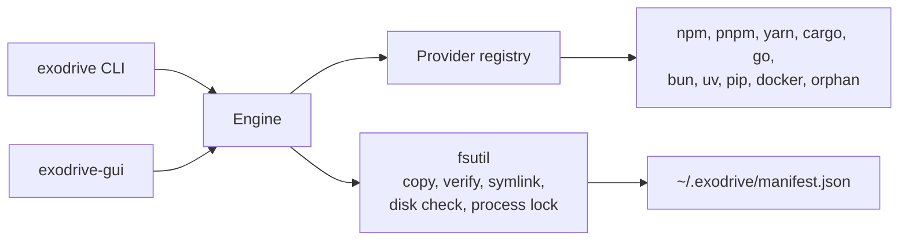

# Exodrive

Move developer caches from your internal disk to an external volume. Exodrive
checks every copy before it deletes the local data. A ledger keeps every move,
so you can move a cache back at any time.

Exodrive ships a command line tool and a native macOS window.

## Status

Exodrive is pre-release software. The version is `0.x`. The ledger format and
the command line may change before version 1.0.

## How a migration works

Exodrive runs the same steps for every toolchain.

1. **Copy.** Exodrive copies the cache to the target volume. It keeps file
   permissions and modification times.
2. **Verify.** Exodrive compares the file count and the total size of both
   trees. A mismatch stops the migration. The local data stays in place.
3. **Record.** Exodrive writes the move to the ledger.
4. **Switch.** Exodrive points the tool at the copy. It uses the tool's own
   configuration, or an atomic symbolic link.
5. **Reclaim.** Exodrive deletes the local copy. The space is free.

A rollback runs the same steps in reverse. Exodrive copies the cache back,
checks the copy, removes the external copy, and deletes the ledger record.



## Safety rules

Exodrive stops before it damages data. It never continues in a weaker mode.

| Rule | Behavior |
|---|---|
| Filesystem allowlist | The target must be APFS, HFS+, ext2/3/4, btrfs, zfs, xfs, f2fs, or bcachefs. Exodrive refuses exFAT, FAT32, NTFS, and every unknown type. |
| Process lock | A running package manager or container engine stops the migration. Stop the tool first. |
| Environment check | A set cache variable wins over the tool settings. Exodrive refuses the move and names the variable. Unset it, then run again. |
| Binary isolation | Exodrive moves caches only. It never moves `~/.cargo/bin`, `~/.bun/bin`, or `$GOPATH/bin`. |
| Verified ledger | Exodrive records a move only after the copy verifies. A rollback reads the record. A missing record stops the rollback. |

Exodrive also refuses a second migration of an item that the ledger already
holds. Run `exodrive rollback <item>` first.

## Supported toolchains

| Toolchain | What moves | How Exodrive redirects | Notes |
|---|---|---|---|
| npm | Global cache | `npm config set cache --global` | Exodrive removes the local cache after the switch. |
| pnpm | Package store | `pnpm config set store-dir --global` | pnpm uses hard links. Keep the store on the volume that holds your projects. |
| yarn | Cache folder | `yarn config set cache-folder --global` | Exodrive writes the global config, not a project file. |
| Cargo | `registry/` and `git/` | Symbolic link for each folder | `~/.cargo/bin` stays on the internal disk. |
| Go | `GOCACHE`, `GOMODCACHE` | `go env -w` | Exodrive moves the module cache and the build cache. |
| Bun | `install/cache` | Symbolic link | `~/.bun/bin` stays on the internal disk. |
| uv | Cache and Python toolchains | Symbolic link | Cross-volume virtual environments use copies. |
| pip | Cache | `pip config set global.cache-dir` | Exodrive uses the official pip setting. |
| Docker (OrbStack) | VM data and images | `data_dir` in `~/.orbstack/config.json` | Stop OrbStack first. |
| Docker Desktop | `Docker.raw` | Symbolic link to the file | Stop Docker Desktop first. |
| Colima | VM disks | Symbolic link to `~/.colima` | Run `colima stop` first. |
| Orphans | Local caches left by an earlier change | `exodrive orphans --clean` deletes them | Run `exodrive orphans` first to review the list. |

## Requirements

- macOS 13 or later for the window. The command line builds on macOS and Linux.
- Go 1.27 or later to build from source.
- An external volume with a supported filesystem.
- Free space on the target volume for one complete copy of each cache.

## Install

Download a release build for macOS or Linux from the
[releases page](https://github.com/Jungley8/exodrive/releases). The archive
holds the command line tool, the window, the README, and the license. Check the
archive against `SHA256SUMS`.

The macOS archive for your architecture also holds `Exodrive.app`. This bundle
is ad-hoc signed. macOS asks for your confirmation the first time you open it:
right-click the app, then choose **Open**.

Or build the command line tool from source:

```sh
go build -o bin/exodrive ./cmd/exodrive
```

Build the macOS window:

```sh
go build -o bin/exodrive-gui ./cmd/exodrive-gui
```

Build the window as a signed app bundle:

```sh
make app
```

Set `SIGN_IDENTITY` to sign with a Developer ID:

```sh
SIGN_IDENTITY="Developer ID Application: Your Name (TEAMID)" make app
```

Set a version string for a release build:

```sh
go build -ldflags "-X main.version=0.1.0" -o bin/exodrive ./cmd/exodrive
```

## Use the command line

Scan every supported toolchain:

```sh
exodrive check
```

Print the scan result as JSON:

```sh
exodrive check --json
```

Check one cache against a target folder:

```sh
exodrive preflight npm.cache --target=/Volumes/External/exodrive
```

Move caches to the target folder:

```sh
exodrive migrate --target=/Volumes/External/exodrive --all
exodrive migrate --target=/Volumes/External/exodrive --tools=npm,pnpm
```

Check what a move would do, without moving data:

```sh
exodrive migrate --target=/Volumes/External/exodrive --all --dry-run
```

Find abandoned caches:

```sh
exodrive orphans
exodrive orphans --clean
```

Move a cache back:

```sh
exodrive rollback npm.cache
```

List the item IDs:

```sh
exodrive check
```

## Use the window

1. Open `bin/exodrive-gui`, or `Exodrive.app`.
2. Press **Browse...** and choose an empty folder on the external volume.
3. Press **Migrate**. Confirm the move.
4. Read the status line. It shows the number of moved caches.
5. To move a cache back, press **Roll back** on its row. Confirm the move.

The window shows local, migrated, and abandoned bytes. It updates the list after
every scan, every move, and every rollback.

## The ledger

Exodrive writes `~/.exodrive/manifest.json`. The file holds one record for each
move: the item, the original path, the destination, the redirect method, the
size, and the time.

Exodrive locks the ledger while it writes, so two runs cannot lose a record.
A record ID appears once.

Set `EXODRIVE_MANIFEST_PATH` to use another file. The tests use this variable.

Keep the ledger and the external volume together. A rollback needs both.

## Limitations

- Exodrive copies data. A large VM disk takes time and temporary space.
- A migration needs the target volume to hold one complete copy.
- A rollback needs the migrated copy on the external volume.
- The process lock reads the process table. A tool that starts under an unusual
  name can pass the check. Stop the tool yourself before you migrate its data.
- The app bundle is ad-hoc signed. A Developer ID needs your own certificate.

## Development

```sh
make build     # build both binaries
make app       # build and sign bin/Exodrive.app
make test      # go test -race ./...
make lint      # gofmt, go vet, golangci-lint
make check     # test and lint
```

The tests use temporary home directories and a temporary ledger. They do not
change your caches. One smoke test reads the real caches to check detection.

The window tests run headless. They mount the real window and press real
controls.

## License

Apache License 2.0. See [LICENSE](LICENSE).
