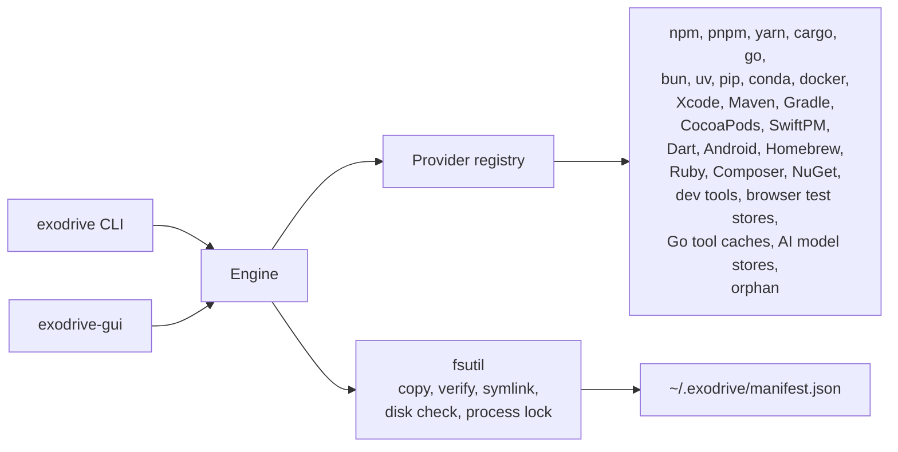

# Exodrive

[](https://github.com/Jungley8/exodrive/actions/workflows/ci.yml)
[](https://github.com/Jungley8/exodrive/releases)
[](LICENSE)
[](go.mod)

**English** | [简体中文](README.zh.md)

Move developer caches from your internal disk to an external volume. Exodrive
checks every copy before it deletes the local data. A ledger keeps every move,
so you can move a cache back at any time.

Exodrive ships a command line tool and a native macOS window.

[Landing page](https://jungley8.github.io/exodrive/) ·
[Documentation](https://jungley8.github.io/exodrive/docs/) ·
[中文文档](https://jungley8.github.io/exodrive/zh/docs/)

## Status

Exodrive is pre-release software. The version is `0.x`. The ledger format and
the command line may change before version 1.0.

## How a migration works

Exodrive runs the same steps for every toolchain.

1. **Copy.** Exodrive copies the cache to the target volume. It keeps file
   permissions and modification times.
2. **Verify.** Exodrive reads every file in both trees and compares the
   content. A single different byte stops the migration. The local data stays
   in place. The same pass computes a digest of the copy.
3. **Record.** Exodrive writes the move to the ledger, with the digest, the
   file count, and the byte count.
4. **Switch.** Exodrive points the tool at the copy. It uses the tool's own
   configuration, or an atomic symbolic link.
5. **Reclaim.** Exodrive deletes the local copy. The space is free.

A rollback runs the same steps in reverse. Exodrive copies the cache back,
checks the copy, removes the external copy, and deletes the ledger record.



## After a move

Exodrive changes the tool's own setting during the switch. The new path takes
effect at the next start of the tool.

- npm, pnpm, yarn, pip, and Go read their setting when a command starts. Open
  a new terminal, or start the tool again.
- cargo, bun, uv, Docker Desktop, Colima, and the AI model stores keep their
  path. Exodrive replaces the folder or the file with a symbolic link, so the
  next start uses the external copy.
- Xcode, Maven, Gradle, CocoaPods, SwiftPM, Dart, Android, Conda, Homebrew,
  Ruby, Composer, NuGet, the Electron, node-gyp, and tsc caches, and the
  Playwright, Cypress, and Puppeteer stores, and the golangci-lint and gopls
  caches keep their path too. Exodrive replaces the folder with a symbolic
  link.
- OrbStack reads `data_dir` at launch. Start OrbStack again.
- A process that already runs keeps the old path. The migration stops while a
  tool runs, so stop the tool first.

Run `exodrive check` to confirm. A moved cache shows the state Migrated.

A tool can delete the link and write its folder again. `exodrive check` then
shows the state Rewritten, and the card says so. The folder on this Mac is real
again, so the tool no longer reaches the copy.

Xcode can delete Derived Data or the previews folder, and then create a real
folder in place of the link. Exodrive keeps the ledger record, so a rollback
compares the two folders first. A rollback that would drop newer files stops,
and Exodrive keeps both folders.

Run `exodrive rollback --keep-local <item>` to keep the folder on this Mac. The
command deletes the copy on the drive and removes the record. The window offers
the same action as **Keep the local folder** on the card, with no failed press
first. The command refuses while the original path is still a link, because the
rollback can finish that case.

## Safety rules

Exodrive stops before it damages data. It never continues in a weaker mode.

| Rule | Behavior |
|---|---|
| Filesystem allowlist | The target must be APFS, HFS+, ext2/3/4, btrfs, zfs, xfs, f2fs, bcachefs, or NTFS. Exodrive refuses exFAT, FAT32, and every unknown type. |
| Process lock | A running package manager or container engine stops the migration. Stop the tool first. |
| Environment check | A set cache variable wins over the tool settings. Exodrive refuses the move and names the variable. Unset it, then run again. |
| Binary isolation | Exodrive moves caches only. It never moves `~/.cargo/bin`, `~/.bun/bin`, or `$GOPATH/bin`. It never moves `~/Library/Developer/CoreSimulator/Devices`. |
| Verified ledger | Exodrive reads both trees and compares the content of every file. It records a move only after the copy verifies. A rollback reads the record. A missing record stops the rollback. |
| Tool answer | Exodrive moves the folder that the tool reports. When the tool does not answer, the cache shows Blocked and Exodrive moves nothing. |

Exodrive also refuses a second migration of an item that the ledger already
holds. Run `exodrive rollback <item>` first.

## Supported toolchains

| Toolchain | What moves | How Exodrive redirects | Notes |
|---|---|---|---|
| npm | Global cache | `npm config set cache --global` | Exodrive removes the local cache after the switch. |
| pnpm | Package store | `pnpm config set store-dir --global` | pnpm uses hard links. Keep the store on the volume that holds your projects. |
| yarn (1.x) | Cache folder | `yarn config set cache-folder --global` | Exodrive writes the global config, not a project file. |
| Cargo | `registry/` and `git/` | Symbolic link for each folder | `~/.cargo/bin` stays on the internal disk. |
| Go | `GOCACHE`, `GOMODCACHE` | `go env -w` | Exodrive moves the module cache and the build cache. |
| Bun | `install/cache` | Symbolic link | `~/.bun/bin` stays on the internal disk. `BUN_INSTALL` names the install root. |
| uv | Cache and Python toolchains | Symbolic link | Cross-volume virtual environments use copies. |
| pip | Cache | `pip config set global.cache-dir` | Exodrive uses the official pip setting. |
| Docker (OrbStack) | VM data and images | `data_dir` in `~/.orbstack/config.json` | Stop OrbStack first. |
| Docker Desktop | `Docker.raw`, or `Docker.qcow2` before version 4.15 | Symbolic link to the file | Stop Docker Desktop first. |
| Colima | VM disks | Symbolic link to `~/.colima` | Run `colima stop` first. |
| Ollama | Model store | Symbolic link to the models folder | Stop `ollama` first. `OLLAMA_MODELS` names the folder. |
| Hugging Face | `hub/` under `HF_HOME` | Symbolic link | Stop a download first. `HF_HOME` names the root, so the link keeps the variable valid. |
| LM Studio | Model store | Symbolic link to the models folder | Quit LM Studio first. |
| Xcode | Derived Data, Archives, iOS/watchOS/tvOS/visionOS Device Support, Previews, and the Xcode cache | Symbolic link for each folder | Quit Xcode first. `~/Library/Developer/CoreSimulator/Devices` stays on this Mac. |
| Maven | `repository/` | Symbolic link | Stop every Maven build first. |
| Gradle | `caches/` and `wrapper/dists/` | Symbolic link | Stop the daemon with `gradle --stop` first. |
| CocoaPods | The cache and the spec repos | Symbolic link | Quit Xcode first. CocoaPods downloads the data again when it needs it. |
| SwiftPM | The package cache | Symbolic link | Quit Xcode first. SwiftPM downloads the packages again when it needs them. |
| Dart and Flutter | `hosted/` and `git/` under the pub cache | Symbolic link for each folder | Stop every build first. `PUB_CACHE` names the root. `bin/` stays on the internal disk. |
| Android | The build cache | Symbolic link | Stop the Gradle daemon with `gradle --stop` first. |
| Conda | Every package folder that `conda info` reports | Symbolic link for each folder | Stop every conda command first. Conda copies packages across volumes, so environments use more space. |
| Homebrew | `downloads/` under the Homebrew cache | Symbolic link | Stop every brew command first. `HOMEBREW_CACHE` names the root. Homebrew downloads the files again when it needs them. |
| Ruby | The Bundler cache and the cache of every user gem folder | Symbolic link for each folder | Stop every `bundle` and `gem` command first. `BUNDLE_USER_CACHE` names the Bundler root. |
| Composer | The download cache | Symbolic link | Stop every composer command first. `COMPOSER_CACHE_DIR` names the root. |
| NuGet | The global package folder | Symbolic link | Stop every dotnet build first. `NUGET_PACKAGES` names the root. |
| Electron, node-gyp, and tsc | The download and build caches | Symbolic link for each folder | Stop the build that fills the cache first. Each tool fills the cache again. |
| Playwright | The browsers that Playwright downloaded | Symbolic link | Stop every test run first. `PLAYWRIGHT_BROWSERS_PATH` names the root. The value `0` keeps the browsers in `node_modules`, so Exodrive reads none. |
| Cypress | The binary bundle that Cypress downloaded | Symbolic link | Stop every test run first. `CYPRESS_CACHE_FOLDER` names the root. Cypress downloads the bundle again when it needs it. |
| Puppeteer | The browsers that Puppeteer downloaded | Symbolic link | Stop every test run first. `PUPPETEER_CACHE_DIR` names the root. Puppeteer downloads a browser again when it needs one. |
| golangci-lint | The analysis cache | Symbolic link | Stop every lint run first. `GOLANGCI_LINT_CACHE` names the root. The next run writes the cache again. |
| gopls | The analysis cache | Symbolic link | Stop every editor session that runs gopls first. The next analysis writes the cache again. |
| Orphans | Local caches left by an earlier change | `exodrive orphans --clean` deletes them | Run `exodrive orphans` first to review the list. |

## Requirements

- An external volume with a supported filesystem: APFS, HFS+, ext2/3/4, btrfs,
  zfs, xfs, f2fs, or bcachefs on macOS and Linux, and NTFS on Windows.
- Free space on the target volume for one complete copy of each cache.
- Go 1.27 or later to build from source.

Exodrive builds for macOS, Linux, and Windows. The support promise covers one
platform only:

| Platform | Window | Command line | Tests |
|---|---|---|---|
| macOS 13 or later | Ships | Ships | Every test runs on macOS |
| Linux | Not shipped | Ships | CI runs the suite on Ubuntu |
| Windows | Ships | Ships | No test runs on Windows |

A bug on a platform without a promise is still a bug. Report it, and the fix
follows the same checks.

## Install

Install the newest release with one command:

```sh
curl -fsSL https://jungley8.github.io/exodrive/install.sh | sh
```

On Windows, run this command in PowerShell:

```powershell
irm https://jungley8.github.io/exodrive/install.ps1 | iex
```

The script reads the newest release, downloads the archive for this machine,
and checks it against `SHA256SUMS`. A mismatch stops it before it writes
anything. On macOS it installs `Exodrive.app` to `~/Applications` and the
command line tool to `~/.local/bin`. On Linux it installs the command line tool
only. On Windows it installs both programs to
`%LOCALAPPDATA%\Programs\Exodrive`.

Read the script before you run it:
<https://jungley8.github.io/exodrive/install.sh> or
<https://jungley8.github.io/exodrive/install.ps1>

| Option | Effect |
|---|---|
| `--cli` | Install the command line tool only |
| `--app` | Install the app bundle only (macOS) |
| `--version <tag>` | Install one release, e.g. `v0.7.0` |
| `--dir <folder>` | Install into another folder |

Or download the archive from the
[releases page](https://github.com/Jungley8/exodrive/releases). The archive
holds the command line tool, the window, the README, and the license. Check the
archive against `SHA256SUMS`.

A download from a browser adds the quarantine flag. macOS asks for your
confirmation the first time you open the app: right-click it, then choose
**Open**. The install script uses `curl`, so no flag is added.

Or build the command line tool from source:

```sh
go build -o bin/exodrive ./cmd/exodrive
```

Build the macOS window:

```sh
go build -o bin/exodrive-gui ./cmd/exodrive-gui
```

Build the window as a signed app bundle:

```sh
make app
```

Set `SIGN_IDENTITY` to sign with a Developer ID:

```sh
SIGN_IDENTITY="Developer ID Application: Your Name (TEAMID)" make app
```

No Developer ID is required. Without `SIGN_IDENTITY`, `make app` signs with an
ad-hoc identity (`codesign --sign -`). macOS opens such a bundle after the
one-time Gatekeeper step above. A Developer ID, the hardened runtime, and
notarization need an Apple Developer Program membership.

A Developer ID build carries the hardened runtime and a secure timestamp. Store
a notary profile once, then build and notarize:

```sh
xcrun notarytool store-credentials exodrive-notary \
  --apple-id you@example.com --team-id TEAMID --password APP_PASSWORD
SIGN_IDENTITY="Developer ID Application: Your Name (TEAMID)" make app
NOTARY_PROFILE=exodrive-notary make notarize
```

`make notarize` uploads the bundle, waits for Apple, staples the ticket, and
checks the bundle with Gatekeeper. It stops when the profile is missing, when
the signature is not a Developer ID, or when Apple rejects the bundle.

Set a version string for a release build:

```sh
go build -ldflags "-X main.version=0.1.0" -o bin/exodrive ./cmd/exodrive
```

## Use the command line

Scan every supported toolchain:

```sh
exodrive check
```

Print the scan result as JSON:

```sh
exodrive check --json
```

Check one cache against a target folder:

```sh
exodrive preflight npm.cache --target=/Volumes/External/exodrive
```

Move caches to the target folder:

```sh
exodrive migrate --target=/Volumes/External/exodrive --all
exodrive migrate --target=/Volumes/External/exodrive --tools=npm,pnpm
```

Check what a move would do, without moving data:

```sh
exodrive migrate --target=/Volumes/External/exodrive --all --dry-run
```

Find abandoned caches:

```sh
exodrive orphans
exodrive orphans --clean
```

Move a cache back:

```sh
exodrive rollback npm.cache
```

List the item IDs:

```sh
exodrive check
```

Check a moved copy against its recorded digest:

```sh
exodrive verify npm.cache
exodrive verify --all
exodrive verify --all --json
```

## Use the window

1. Open `bin/exodrive-gui`, or `Exodrive.app`. The first start shows three
   steps. Press **Skip** to close the card. The window does not show it again.
2. Choose a folder on the external drive. Press **Choose** to open the folder
   panel of macOS, or type the path. The panel lists every connected drive.
   The window checks the folder and shows the free space of the drive. A folder
   on this Mac frees no space, and the window says so.
3. Select the caches to move. Press **Select all N**, or press the box on one
   card.
4. Press **Move N caches**. Read the list, then press **Move**. A long move
   shows its progress, and **Stop after this cache** stops it at the end of the
   cache that copies now. To move one cache, press **Move** on its card.
5. To move a cache back, press **Move back** on its card. Confirm the move.
6. To check a moved copy, press **Check the copy** on its card. The card shows
   the answer and the next step.
7. To delete an unused cache, press **Delete cache** on its card. Confirm the
   delete. This action cannot be undone.

The window shows two gauges. The left gauge holds the free space of this Mac and
the bytes in caches. The right gauge holds the free space of the drive and the
bytes that moved.

A move sends caches to the folder you chose. Each move keeps its own folder in
the record, so caches can sit on more than one drive. To use another drive,
press **Choose** again. The right gauge counts the caches under the folder it
shows.

Every cache is a card. A card shows the name, the size, and one state word:
**On this Mac**, **On the drive**, **Cannot move**, or **Unused**. A card also
shows its folder, its copy, and the change that Exodrive makes. A program
setting applies at the next start of the program. A symbolic link changes
nothing for the program.

The rail on the left lists the groups that Exodrive found: Node, Python, Ruby,
Rust, Go, Apple, JVM, Mobile, Homebrew, and Docker. A bar under each name shows
how much of that group sits on this Mac and how much already moved. Press a group
to show only its caches. Press **All caches** to show every group.

The filter above the list keeps one place: **All**, **On this Mac**, or **On the
drive**. The rail and the filter both narrow the list, and a move acts on the
caches on screen. A filter change clears the selection.

A move that stops keeps its reason on the card, and Exodrive deletes nothing.
Read the next step, then press **Try again**. The footer shows **Details**,
which names the record file that a move back needs.

The window reads the PATH of your login shell. A tool installed by Homebrew,
nvm, or a custom folder is found after you open the app from Finder or the
Dock.

The list refreshes after every scan, every move, and every rollback. A cache
that Exodrive cannot move says **Cannot move**, and the card holds the reason.
Yarn 2 and later are blocked: they read `cacheFolder` from each project's
`.yarnrc.yml`, so a global move does not reach them. Delete that cache, or keep
it. A cache is also blocked when its tool does not report the cache folder. Put
the tool on PATH, then press **Rescan**.

### Language

The window shows English or Simplified Chinese. It reads the system language.
Set `EXODRIVE_LANG=zh` or `EXODRIVE_LANG=en` to choose one for a single start.

Exodrive translates the words the window writes. A message from a toolchain or
from the filesystem stays as that program wrote it, so the reason stays exact.

### A newer release

The window checks the public release list of GitHub once per start. A newer
release adds one line to the footer with a button that opens the release page.
Exodrive does not download or replace its own app bundle. Set
`EXODRIVE_NO_UPDATE_CHECK=1` to turn the check off. A failed check shows
nothing.

### Stop the window

macOS closes the window without asking, and Exodrive cannot hold the close
open. A move writes `~/.exodrive/inflight.json` before it starts and removes
that file when it ends. The next start names the cache that was changing.

Press **Stop after this cache** to end a long move between caches. The cache
that copies now finishes first.

A window that closes in the middle of a copy leaves a partial copy on the drive
and the full cache on this Mac. Run a check. If the card still says **On this
Mac**, move the cache again.

## The ledger

Exodrive writes `~/.exodrive/manifest.json`. The file holds one record for each
move: the item, the original path, the destination, the redirect method, the
size, the time, and the digest of the copy.

Exodrive locks the ledger while it writes, so two runs cannot lose a record.
A record ID appears once.

Set `EXODRIVE_MANIFEST_PATH` to use another file. The tests use this variable.

Keep the ledger and the external volume together. A rollback needs both.

## Check a moved copy

A move records a digest of the copy. Press **Check the copy** on a card, or run:

```sh
exodrive verify --all
exodrive verify npm.cache
exodrive verify --all --json
```

The check reads the copy again and compares the two digests. It writes nothing
to the drive. The command prints one line for each copy. It exits with code 1
when a copy is not ok.

A check reports one of four states:

- **ok**: the copy holds the bytes that the move wrote.
- **changed**: a file in the copy differs from the move. Move the cache back,
  then move it again.
- **missing**: the copy is not at the recorded path. Connect the drive.
- **unverified**: the record holds no digest. A record from an older Exodrive
  holds none. Move the cache back, then move it again.

A check never reports **ok** for a record it cannot prove.

## When something fails

Exodrive shows the reason on the card or in the banner. It also writes one line
to `~/.exodrive/failures.jsonl`. The line holds the time, the version, the
platform, the step, the kind, the cache, and the message. The home folder reads
as `~`. The file stops at 256 KB and keeps the newest lines.

Press **Copy details** on a failed card to copy that failure. Press **Report a
problem** in the footer to read the exact text that a report carries. The
dialog offers **Copy details** and **Open a GitHub issue**. The issue opens in
your browser with a title and a body that you can edit. Exodrive sends nothing
by itself.

In the terminal, run `exodrive doctor`. It prints the same facts.

Set `EXODRIVE_NO_FAILURE_LOG=1` to stop the log. Delete the file to remove every
record.

## Limitations

- Exodrive copies data. A large VM disk takes time and temporary space.
- Verification reads every file in both trees. A large cache takes about the
  time of a second copy before the switch runs.
- A check reads the copy again, so a large copy takes time.
- A migration needs the target volume to hold one complete copy.
- A rollback needs the migrated copy on the external volume.
- The process lock reads the process table. A tool that starts under an unusual
  name can pass the check. Stop the tool yourself before you migrate its data.
- Exodrive does not read the Xcode setting for a custom Derived Data location.
  A cache at that location stays out of the list.
- A blocked folder such as the simulator store is measured on every scan. A
  large store makes a scan slower.
- A move keeps file permissions, modification times, and symbolic links. It
  does not keep extended attributes.
- The app bundle is ad-hoc signed. A Developer ID needs your own certificate.

## Development

```sh
make build     # build both binaries
make app       # build and sign bin/Exodrive.app
make icon      # rebuild packaging/AppIcon.icns from packaging/icon.svg
make test      # go test -race ./...
make lint      # gofmt, go vet, golangci-lint
make check     # test and lint
```

The tests use temporary home directories and a temporary ledger. They do not
change your caches. One smoke test reads the real caches to check detection.

The window tests run headless. They mount the real window and press real
controls.

## License

Apache License 2.0. See [LICENSE](LICENSE).
