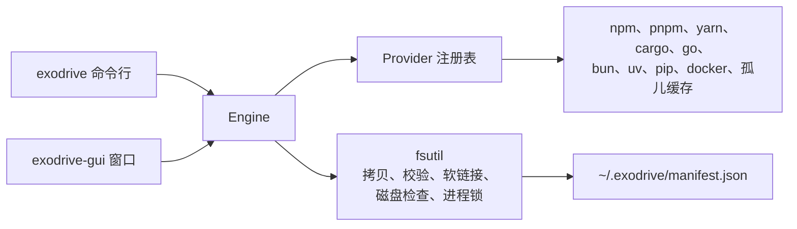

# Exodrive

[](https://github.com/Jungley8/exodrive/actions/workflows/ci.yml)
[](https://github.com/Jungley8/exodrive/releases)
[](LICENSE)
[](go.mod)

[English](README.md) | **简体中文**

把开发缓存从内置磁盘迁移到外置磁盘。Exodrive 先校验副本，再删除本地数据。所有迁移都记入账本，可随时回滚。

Exodrive 提供一个命令行工具和一个 macOS 原生窗口。

## 状态

Exodrive 处于预发布阶段，版本号为 `0.x`。1.0 之前，账本格式和命令行参数可能变化。

## 迁移流程

每种工具链都走相同的五步。

1. **拷贝**：把缓存复制到目标磁盘，保留文件权限和修改时间。
2. **校验**：读取两侧的每个文件并比对内容。任何一个字节不同都立即停止，本地数据保持原样。
3. **记账**：把本次迁移写入账本。
4. **切换**：把工具指向副本。使用工具自带的配置命令，或原子软链接。
5. **回收**：删除本地副本，释放空间。

回滚是反向的步骤：复制回本地、校验、删除外置副本、删除账本记录。



## 迁移后如何生效

Exodrive 在切换步骤改写工具自身的配置。工具下次启动时读取新路径。

- npm、pnpm、yarn、pip、Go 在命令启动时读取配置。开一个新终端，或重新启动该工具。
- cargo、bun、uv、Docker Desktop、Colima 的路径不变。Exodrive 把原目录或原文件换成软链接，下次启动直接使用外置副本。
- OrbStack 在启动时读取 `data_dir`。重新启动 OrbStack。
- 已经在运行的进程仍持有旧路径。迁移在工具运行时拒绝执行，所以先停止工具。

执行 `exodrive check` 确认结果。已迁移的缓存状态显示为 Migrated。

## 安全规则

数据可能受损时，Exodrive 直接停止，不会退化为弱安全模式。

| 规则 | 行为 |
|---|---|
| 文件系统白名单 | 目标必须是 APFS、HFS+、ext2/3/4、btrfs、zfs、xfs、f2fs 或 bcachefs。拒绝 exFAT、FAT32、NTFS，以及任何未知类型。 |
| 进程互斥 | 包管理器或容器引擎正在运行时，拒绝迁移。先停止该工具。 |
| 环境变量检查 | 缓存路径的环境变量优先于工具配置。Exodrive 拒绝迁移，并指出该变量。清除后再执行。 |
| 二进制隔离 | 只迁移缓存，不迁移 `~/.cargo/bin`、`~/.bun/bin`、`$GOPATH/bin`。 |
| 账本校验 | 先读取两侧全部文件、比对内容，通过后才写入账本。回滚只认账本记录，没有记录就拒绝执行。 |
| 工具自报路径 | 只迁移工具自己报告的目录。工具不回答时，该缓存显示 Blocked，不做任何移动。 |
| 目标目录检查 | 目标目录不存在时拒绝执行。外置盘未连接时，提示先连接磁盘。 |

账本已有记录的条目不能再次迁移。先执行 `exodrive rollback <item>`。

## 支持的工具链

| 工具链 | 迁移内容 | 切换方式 | 说明 |
|---|---|---|---|
| npm | 全局缓存 | `npm config set cache --global` | 切换成功后删除本地缓存。 |
| pnpm | 包仓库 | `pnpm config set store-dir --global` | pnpm 使用硬链接。仓库应与项目位于同一磁盘。 |
| yarn（1.x） | 缓存目录 | `yarn config set cache-folder --global` | 只写全局配置，不改项目文件。 |
| Cargo | `registry/` 与 `git/` | 分别建立软链接 | `~/.cargo/bin` 保留在内置磁盘。 |
| Go | `GOCACHE`、`GOMODCACHE` | `go env -w` | 模块缓存和构建缓存都迁移。 |
| Bun | `install/cache` | 软链接 | `~/.bun/bin` 保留在内置磁盘。安装根目录由 `BUN_INSTALL` 指定。 |
| uv | 缓存与 Python 工具链 | 软链接 | 跨磁盘创建虚拟环境时使用复制。 |
| pip | 缓存 | `pip config set global.cache-dir` | 使用 pip 官方配置项。 |
| Docker（OrbStack） | VM 数据与镜像 | `~/.orbstack/config.json` 的 `data_dir` | 先停止 OrbStack。 |
| Docker Desktop | `Docker.raw`，4.15 之前的版本为 `Docker.qcow2` | 指向文件的软链接 | 先停止 Docker Desktop。 |
| Colima | VM 磁盘 | 指向 `~/.colima` 的软链接 | 先执行 `colima stop`。 |
| 孤儿缓存 | 配置变更后遗留的本地缓存 | `exodrive orphans --clean` 删除 | 先执行 `exodrive orphans` 查看列表。 |

## 环境要求

- 窗口需要 macOS 13 或更高版本。命令行可在 macOS 和 Linux 上构建。
- 从源码构建需要 Go 1.27 或更高版本。
- 需要一块文件系统受支持的外置磁盘。
- 目标磁盘需要容纳每个缓存的完整副本。

## 安装

从[发布页](https://github.com/Jungley8/exodrive/releases)下载 macOS 或 Linux 的构建包。压缩包内含命令行工具、窗口程序、README 和许可证。用 `SHA256SUMS` 校验文件。

对应架构的 macOS 包还含 `Exodrive.app`。该应用为 ad-hoc 签名，macOS 首次打开时会要求确认：右键点按应用，选择**打开**。也可在终端里一次性去掉隔离标记：

```sh
xattr -d com.apple.quarantine Exodrive.app
```

也可以从源码构建命令行工具：

```sh
go build -o bin/exodrive ./cmd/exodrive
```

构建 macOS 窗口：

```sh
go build -o bin/exodrive-gui ./cmd/exodrive-gui
```

构建带签名的应用包：

```sh
make app
```

用 Developer ID 签名：

```sh
SIGN_IDENTITY="Developer ID Application: Your Name (TEAMID)" make app
```

没有 Developer ID 也能打包。不设 `SIGN_IDENTITY` 时，`make app` 用 ad-hoc 身份签名（`codesign --sign -`）。macOS 在完成上文的首次确认后即可打开。Developer ID、强化运行时与公证需要 Apple Developer Program 会员资格。

用 Developer ID 打包时，应用带强化运行时和安全时间戳。先保存一次公证凭据，再打包并公证：

```sh
xcrun notarytool store-credentials exodrive-notary \
  --apple-id you@example.com --team-id TEAMID --password APP_PASSWORD
SIGN_IDENTITY="Developer ID Application: Your Name (TEAMID)" make app
NOTARY_PROFILE=exodrive-notary make notarize
```

`make notarize` 会上传应用包、等待 Apple 处理、把票据钉入应用，并用 Gatekeeper 检查。凭据缺失、签名不是 Developer ID、或 Apple 拒绝时，命令直接失败。

发布构建时写入版本号：

```sh
go build -ldflags "-X main.version=0.1.0" -o bin/exodrive ./cmd/exodrive
```

## 命令行用法

扫描全部工具链：

```sh
exodrive check
```

以 JSON 输出扫描结果：

```sh
exodrive check --json
```

检查单个缓存与目标目录：

```sh
exodrive preflight npm.cache --target=/Volumes/External/exodrive
```

迁移缓存：

```sh
exodrive migrate --target=/Volumes/External/exodrive --all
exodrive migrate --target=/Volumes/External/exodrive --tools=npm,pnpm
```

只看计划、不动数据：

```sh
exodrive migrate --target=/Volumes/External/exodrive --all --dry-run
```

检查孤儿缓存：

```sh
exodrive orphans
exodrive orphans --clean
```

回滚一个条目：

```sh
exodrive rollback npm.cache
```

条目 ID 由 `exodrive check` 输出。

## 窗口用法

1. 打开 `bin/exodrive-gui` 或 `Exodrive.app`。
2. 选择外置磁盘上的一个目录。点 **Choose** 打开 macOS 的目录面板，或直接在输入框里填路径。面板列出所有已连接的磁盘。窗口会检查该目录，并显示磁盘可用空间。选在本机的目录不会释放空间，窗口会提示这一点，但不阻止迁移。
3. 勾选要迁移的缓存。点 **Select all N** 全选，或点每张卡片左侧的勾选框。
4. 点 **Move N caches**。看清列出的条目，再点 **Move** 开始。长时间迁移会显示进度；点 **Stop after this cache** 会让当前这一项做完后停下。只搬一项时，点该卡片上的 **Move**。
5. 把缓存搬回本地：点该卡片上的 **Move back** 并确认。
6. 删除不再使用的缓存：点该卡片上的 **Delete cache** 并确认。删除不可撤销。

窗口顶部有两个容量条。左边是这台 Mac 的剩余空间和缓存占用，右边是外置磁盘的剩余空间和已迁移的大小。

迁移只写入当前选中的目录。账本里每条记录各自保存自己的目标目录，所以缓存可以分布在多块磁盘上。要用另一块磁盘，再点一次 **Choose**。右侧容量条只统计当前目录下的缓存。

每个缓存是一张卡片。卡片显示名称、大小和一个状态词：**On this Mac**、**On the drive**、**Cannot move** 或 **Unused**；同时列出该缓存的目录、副本目录，以及 Exodrive 做的改动。改程序配置的，程序下次启动时生效；建软链接的，程序侧没有任何变化。

左侧的栏按工具链分组列出检测结果：Node、Python、Rust、Go、Docker。每个分组下的横条显示这一组有多少还在本机、多少已经搬走。点某个分组，右边只显示该组的缓存；点 **All caches** 恢复全部。

列表上方的筛选器保留一个位置：**All**、**On this Mac** 或 **On the drive**。分组和位置筛选都会收窄列表，迁移只作用于屏幕上看到的缓存；切换筛选会清空当前勾选。

迁移中断时，原因留在卡片上，Exodrive 不会删除任何数据。按卡片的提示处理后点 **Try again**。窗口底部的 **Details** 显示搬回时需要的记录文件位置。

窗口启动时读取登录 shell 的 PATH。从 Finder 或 Dock 打开时，Homebrew、nvm 或自定义目录里的工具同样能找到。

每次扫描、迁移和回滚后，列表自动刷新。Exodrive 无法迁移的缓存显示 **Cannot move**，原因在卡片上。yarn 2 及更高版本都会被阻止：它们的 `cacheFolder` 写在每个项目的 `.yarnrc.yml` 里，全局切换无法覆盖。可删除该缓存，或保留。工具没有报告缓存目录时同样显示 **Cannot move**：把该工具加入 PATH，再点 **Rescan**。

## 账本

账本文件为 `~/.exodrive/manifest.json`。每次迁移写入一条记录：条目、原路径、目标路径、切换方式、大小和时间。

写入时加锁，两个进程不会互相覆盖。同一条目只保留一条记录。

设置 `EXODRIVE_MANIFEST_PATH` 可改用其他文件，测试即使用此变量。

账本要与外置磁盘一起保留。回滚需要两者都在。

## 限制

- 迁移是拷贝操作。大容量 VM 磁盘需要时间和临时空间。
- 校验会读取两侧的全部文件。大缓存切换前需要约等于再拷贝一遍的时间。
- 迁移需要目标磁盘容纳完整副本。
- 回滚需要外置磁盘上的副本仍然存在。
- 进程锁读取进程表。启动方式特殊的工具可能绕过检查，迁移前请自行停止该工具。
- 应用包为 ad-hoc 签名。使用 Developer ID 需要你自己的证书。

## 开发

```sh
make build     # 构建两个二进制
make app       # 构建并签名 bin/Exodrive.app
make icon      # 由 packaging/icon.svg 重新生成 packaging/AppIcon.icns
make test      # go test -race ./...
make lint      # gofmt、go vet、golangci-lint
make check     # 测试与检查
```

测试使用临时主目录和临时账本，不会改动真实缓存。有一个冒烟测试会读取真实缓存的体积，用于验证检测逻辑。

窗口测试以无头方式运行，挂载真实窗口并模拟点击。

## 许可证

Apache License 2.0，见 [LICENSE](LICENSE)。
