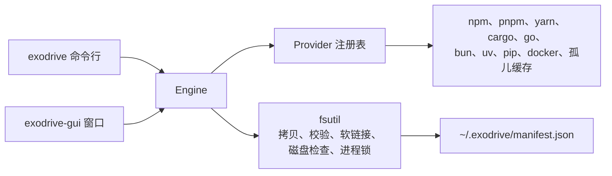

# Exodrive

把开发缓存从内置磁盘迁移到外置磁盘。Exodrive 先校验副本，再删除本地数据。所有迁移都记入账本，可随时回滚。

Exodrive 提供一个命令行工具和一个 macOS 原生窗口。

## 状态

Exodrive 处于预发布阶段，版本号为 `0.x`。1.0 之前，账本格式和命令行参数可能变化。

## 迁移流程

每种工具链都走相同的五步。

1. **拷贝**：把缓存复制到目标磁盘，保留文件权限和修改时间。
2. **校验**：比对两侧的文件数量和总字节数。不一致则立即停止，本地数据保持原样。
3. **记账**：把本次迁移写入账本。
4. **切换**：把工具指向副本。使用工具自带的配置命令，或原子软链接。
5. **回收**：删除本地副本，释放空间。

回滚是反向的步骤：复制回本地、校验、删除外置副本、删除账本记录。



## 安全规则

数据可能受损时，Exodrive 直接停止，不会退化为弱安全模式。

| 规则 | 行为 |
|---|---|
| 文件系统白名单 | 目标必须是 APFS、HFS+、ext2/3/4、btrfs、zfs、xfs、f2fs 或 bcachefs。拒绝 exFAT、FAT32、NTFS，以及任何未知类型。 |
| 进程互斥 | 包管理器或容器引擎正在运行时，拒绝迁移。先停止该工具。 |
| 环境变量检查 | 缓存路径的环境变量优先于工具配置。Exodrive 拒绝迁移，并指出该变量。清除后再执行。 |
| 二进制隔离 | 只迁移缓存，不迁移 `~/.cargo/bin`、`~/.bun/bin`、`$GOPATH/bin`。 |
| 账本校验 | 副本校验通过后才写入账本。回滚只认账本记录，没有记录就拒绝执行。 |

账本已有记录的条目不能再次迁移。先执行 `exodrive rollback <item>`。

## 支持的工具链

| 工具链 | 迁移内容 | 切换方式 | 说明 |
|---|---|---|---|
| npm | 全局缓存 | `npm config set cache --global` | 切换成功后删除本地缓存。 |
| pnpm | 包仓库 | `pnpm config set store-dir --global` | pnpm 使用硬链接。仓库应与项目位于同一磁盘。 |
| yarn | 缓存目录 | `yarn config set cache-folder --global` | 只写全局配置，不改项目文件。 |
| Cargo | `registry/` 与 `git/` | 分别建立软链接 | `~/.cargo/bin` 保留在内置磁盘。 |
| Go | `GOCACHE`、`GOMODCACHE` | `go env -w` | 模块缓存和构建缓存都迁移。 |
| Bun | `install/cache` | 软链接 | `~/.bun/bin` 保留在内置磁盘。 |
| uv | 缓存与 Python 工具链 | 软链接 | 跨磁盘创建虚拟环境时使用复制。 |
| pip | 缓存 | `pip config set global.cache-dir` | 使用 pip 官方配置项。 |
| Docker（OrbStack） | VM 数据与镜像 | `~/.orbstack/config.json` 的 `data_dir` | 先停止 OrbStack。 |
| Docker Desktop | `Docker.raw` | 指向文件的软链接 | 先停止 Docker Desktop。 |
| Colima | VM 磁盘 | 指向 `~/.colima` 的软链接 | 先执行 `colima stop`。 |
| 孤儿缓存 | 配置变更后遗留的本地缓存 | `exodrive orphans --clean` 删除 | 先执行 `exodrive orphans` 查看列表。 |

## 环境要求

- 窗口需要 macOS 13 或更高版本。命令行可在 macOS 和 Linux 上构建。
- 从源码构建需要 Go 1.27 或更高版本。
- 需要一块文件系统受支持的外置磁盘。
- 目标磁盘需要容纳每个缓存的完整副本。

## 安装

从[发布页](https://github.com/Jungley8/exodrive/releases)下载 macOS 或 Linux 的构建包。压缩包内含命令行工具、窗口程序、README 和许可证。用 `SHA256SUMS` 校验文件。

对应架构的 macOS 包还含 `Exodrive.app`。该应用为 ad-hoc 签名，macOS 首次打开时会要求确认：右键点按应用，选择**打开**。

也可以从源码构建命令行工具：

```sh
go build -o bin/exodrive ./cmd/exodrive
```

构建 macOS 窗口：

```sh
go build -o bin/exodrive-gui ./cmd/exodrive-gui
```

构建带签名的应用包：

```sh
make app
```

用 Developer ID 签名：

```sh
SIGN_IDENTITY="Developer ID Application: Your Name (TEAMID)" make app
```

发布构建时写入版本号：

```sh
go build -ldflags "-X main.version=0.1.0" -o bin/exodrive ./cmd/exodrive
```

## 命令行用法

扫描全部工具链：

```sh
exodrive check
```

以 JSON 输出扫描结果：

```sh
exodrive check --json
```

检查单个缓存与目标目录：

```sh
exodrive preflight npm.cache --target=/Volumes/External/exodrive
```

迁移缓存：

```sh
exodrive migrate --target=/Volumes/External/exodrive --all
exodrive migrate --target=/Volumes/External/exodrive --tools=npm,pnpm
```

只看计划、不动数据：

```sh
exodrive migrate --target=/Volumes/External/exodrive --all --dry-run
```

检查孤儿缓存：

```sh
exodrive orphans
exodrive orphans --clean
```

回滚一个条目：

```sh
exodrive rollback npm.cache
```

条目 ID 由 `exodrive check` 输出。

## 窗口用法

1. 打开 `bin/exodrive-gui` 或 `Exodrive.app`。
2. 点击 **Browse...**，选择外置磁盘上的空目录。
3. 点击 **Migrate**，并在确认框中确认。
4. 查看状态栏，其中显示已迁移的数量。
5. 要把某个缓存搬回本地，点该行的 **Roll back** 并确认。

窗口显示本地、已迁移、孤儿三类占用。每次扫描、迁移和回滚后，列表自动刷新。

## 账本

账本文件为 `~/.exodrive/manifest.json`。每次迁移写入一条记录：条目、原路径、目标路径、切换方式、大小和时间。

写入时加锁，两个进程不会互相覆盖。同一条目只保留一条记录。

设置 `EXODRIVE_MANIFEST_PATH` 可改用其他文件，测试即使用此变量。

账本要与外置磁盘一起保留。回滚需要两者都在。

## 限制

- 迁移是拷贝操作。大容量 VM 磁盘需要时间和临时空间。
- 迁移需要目标磁盘容纳完整副本。
- 回滚需要外置磁盘上的副本仍然存在。
- 进程锁读取进程表。启动方式特殊的工具可能绕过检查，迁移前请自行停止该工具。
- 应用包为 ad-hoc 签名。使用 Developer ID 需要你自己的证书。

## 开发

```sh
make build     # 构建两个二进制
make app       # 构建并签名 bin/Exodrive.app
make test      # go test -race ./...
make lint      # gofmt、go vet、golangci-lint
make check     # 测试与检查
```

测试使用临时主目录和临时账本，不会改动真实缓存。有一个冒烟测试会读取真实缓存的体积，用于验证检测逻辑。

窗口测试以无头方式运行，挂载真实窗口并模拟点击。

## 许可证

Apache License 2.0，见 [LICENSE](LICENSE)。
