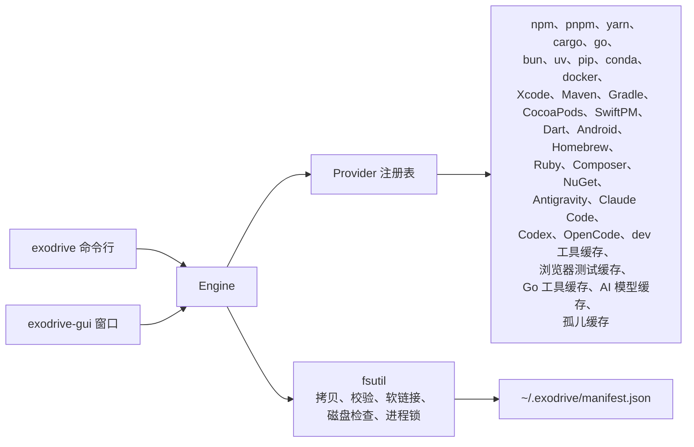

# Exodrive

[](https://github.com/Jungley8/exodrive/actions/workflows/ci.yml)
[](https://github.com/Jungley8/exodrive/releases)
[](LICENSE)
[](go.mod)

[English](README.md) | **简体中文**

把开发缓存从内置磁盘迁移到外置磁盘。Exodrive 先校验副本，再删除本地数据。所有迁移都记入账本，可随时回滚。

Exodrive 提供一个命令行工具和一个 macOS 原生窗口。

[产品主页](https://jungley8.github.io/exodrive/zh/) ·
[文档](https://jungley8.github.io/exodrive/zh/docs/) ·
[English docs](https://jungley8.github.io/exodrive/docs/)

## 状态

Exodrive 处于预发布阶段，版本号为 `0.x`。1.0 之前，账本格式和命令行参数可能变化。

## 迁移流程

每种工具链都走相同的五步。

1. **拷贝**：把缓存复制到目标磁盘，保留文件权限和修改时间。
2. **校验**：读取两侧的每个文件并比对内容。任何一个字节不同都立即停止，本地数据保持原样。同一次读取同时算出副本摘要。
3. **记账**：把本次迁移写入账本，带摘要、文件数和总字节数。
4. **切换**：把工具指向副本。使用工具自带的配置命令，或原子软链接。
5. **回收**：删除本地副本，释放空间。

回滚是反向的步骤：复制回本地、校验、删除外置副本、删除账本记录。



## 迁移后如何生效

Exodrive 在切换步骤改写工具自身的配置。工具下次启动时读取新路径。

- npm、pnpm、yarn、pip、Go 在命令启动时读取配置。开一个新终端，或重新启动该工具。
- cargo、bun、uv、Docker Desktop、Colima 以及 AI 模型缓存的路径不变。Exodrive 把原目录或原文件换成软链接，下次启动直接使用外置副本。
- Xcode、Maven、Gradle、CocoaPods、SwiftPM、Dart、Android、Conda、Homebrew、Ruby、Composer、NuGet、Antigravity、Claude Code、Codex、OpenCode、Electron、node-gyp、tsc、Playwright、Cypress、Puppeteer，以及 golangci-lint、gopls 缓存的路径同样不变。Exodrive 把目录换成软链接。
- OrbStack 在启动时读取 `data_dir`。重新启动 OrbStack。
- 已经在运行的进程仍持有旧路径。迁移在工具运行时拒绝执行，所以先停止工具。

执行 `exodrive check` 确认结果。已迁移的缓存状态显示为 Migrated。

工具可能删掉软链接，在原位置重写自己的目录。此时 `exodrive check` 显示状态 Rewritten，卡片也会说明。本机目录已经真实存在，工具不再通过副本读取。

记录保存的是它搬走的那个目录。工具以后可能改读另一个目录。扫描会停下这一行，并列出两个目录。执行 `exodrive rollback <item>` 取回副本，再扫描一次。

Xcode 可能删除 DerivedData 或 Previews 目录，并在原位置重建真实目录。账本里的记录仍然保留，所以回滚会先比对两个目录。回滚会丢失较新的文件时，Exodrive 停止，两个目录都保留。

要保留本机目录，执行 `exodrive rollback --keep-local <item>`。该命令删除磁盘上的副本，并移除账本记录。窗口在卡片上直接提供同样的操作：**保留本机目录**，不需要先失败一次。原路径仍是软链接时，该命令拒绝执行，因为这种情况交给回滚完成。

## 安全规则

数据可能受损时，Exodrive 直接停止，不会退化为弱安全模式。

| 规则 | 行为 |
|---|---|
| 文件系统白名单 | 目标必须是 APFS、HFS+、ext2/3/4、btrfs、zfs、xfs、f2fs、bcachefs 或 NTFS。拒绝 exFAT、FAT32，以及任何未知类型。 |
| 进程互斥 | 包管理器或容器引擎正在运行时，拒绝迁移。先停止该工具。 |
| 环境变量检查 | 缓存路径的环境变量优先于工具配置。Exodrive 拒绝迁移，并指出该变量。清除后再执行。 |
| 二进制隔离 | 只迁移缓存，不迁移 `~/.cargo/bin`、`~/.bun/bin`、`$GOPATH/bin`。也不迁移 `~/Library/Developer/CoreSimulator/Devices`。 |
| 账本校验 | 先读取两侧全部文件、比对内容，通过后才写入账本。回滚只认账本记录，没有记录就拒绝执行。 |
| 工具自报路径 | 只迁移工具自己报告的目录。工具不回答时，该缓存显示 Blocked，不做任何移动。 |
| 目标目录检查 | 目标目录不存在时拒绝执行。外置盘未连接时，提示先连接磁盘。 |

账本已有记录的条目不能再次迁移。先执行 `exodrive rollback <item>`。

## 支持的工具链

| 工具链 | 迁移内容 | 切换方式 | 说明 |
|---|---|---|---|
| npm | 全局缓存 | `npm config set cache --global` | 切换成功后删除本地缓存。 |
| pnpm | 包仓库 | `pnpm config set store-dir --global` | pnpm 使用硬链接。仓库应与项目位于同一磁盘。 |
| yarn（1.x） | 缓存目录 | `yarn config set cache-folder --global` | 只写全局配置，不改项目文件。 |
| Cargo | `registry/` 与 `git/` | 分别建立软链接 | `~/.cargo/bin` 保留在内置磁盘。 |
| Go | `GOCACHE`、`GOMODCACHE` | `go env -w` | 模块缓存和构建缓存都迁移。 |
| Bun | `install/cache` | 软链接 | `~/.bun/bin` 保留在内置磁盘。安装根目录由 `BUN_INSTALL` 指定。 |
| uv | 缓存与 Python 工具链 | 软链接 | 跨磁盘创建虚拟环境时使用复制。 |
| pip | 缓存 | `pip config set global.cache-dir` | 使用 pip 官方配置项。 |
| Docker（OrbStack） | VM 数据与镜像 | `~/.orbstack/config.json` 的 `data_dir` | 先停止 OrbStack。 |
| Docker Desktop | `Docker.raw`，4.15 之前的版本为 `Docker.qcow2` | 指向文件的软链接 | 先停止 Docker Desktop。 |
| Colima | VM 磁盘 | 指向 `~/.colima` 的软链接 | 先执行 `colima stop`。 |
| Ollama | 模型仓库 | 指向模型目录的软链接 | 先停止 `ollama`。目录由 `OLLAMA_MODELS` 指定。 |
| Hugging Face | `HF_HOME` 下的 `hub/` | 软链接 | 先停止正在进行的下载。`HF_HOME` 指向根目录，软链接让它继续有效。 |
| LM Studio | 模型仓库 | 指向模型目录的软链接 | 先退出 LM Studio。 |
| Xcode | DerivedData、Archives、iOS/watchOS/tvOS/visionOS DeviceSupport、Previews 与 Xcode 缓存 | 分别为每个目录建立软链接 | 先退出 Xcode。`~/Library/Developer/CoreSimulator/Devices` 保留在本机。 |
| Maven | `repository/` | 软链接 | 先停止所有 Maven 构建。 |
| Gradle | `caches/` 与 `wrapper/dists/` | 软链接 | 先执行 `gradle --stop` 停止守护进程。 |
| CocoaPods | 缓存与 spec 仓库 | 软链接 | 先退出 Xcode。需要时 CocoaPods 会重新下载。 |
| SwiftPM | 包缓存 | 软链接 | 先退出 Xcode。需要时 SwiftPM 会重新下载依赖包。 |
| Dart / Flutter | pub 缓存中的 `hosted/` 与 `git/` | 分别为每个目录建立软链接 | 先停止所有构建。根目录由 `PUB_CACHE` 指定。`bin/` 保留在内置磁盘。 |
| Android | 构建缓存与模拟器镜像 | 分别为每个目录建立软链接 | 先执行 `gradle --stop` 停止守护进程。根目录由 `ANDROID_AVD_HOME` 指定。先停止模拟器。磁盘慢会拖慢每次启动，请使用速度较快的外置 SSD。 |
| Conda | `conda info` 报告的每个包目录 | 分别为每个目录建立软链接 | 先停止所有 conda 命令。跨磁盘时 conda 复制包，环境占用更多空间。 |
| Homebrew | Homebrew 缓存中的 `downloads/` | 软链接 | 先停止所有 brew 命令。根目录由 `HOMEBREW_CACHE` 指定。需要时 Homebrew 会重新下载。 |
| Ruby | Bundler 缓存，以及每个用户 gem 目录下的缓存 | 分别为每个目录建立软链接 | 先停止所有 `bundle` 与 `gem` 命令。Bundler 根目录由 `BUNDLE_USER_CACHE` 指定。 |
| Composer | 下载缓存 | 软链接 | 先停止所有 composer 命令。根目录由 `COMPOSER_CACHE_DIR` 指定。 |
| NuGet | 全局包目录 | 软链接 | 先停止所有 dotnet 构建。根目录由 `NUGET_PACKAGES` 指定。 |
| Electron、node-gyp、tsc | 下载缓存与构建缓存 | 分别为每个目录建立软链接 | 先停止正在写这个缓存的构建。需要时每个工具会重新缓存。 |
| Playwright | Playwright 下载的浏览器 | 软链接 | 先停止所有测试。根目录由 `PLAYWRIGHT_BROWSERS_PATH` 指定。值为 `0` 时浏览器放在 `node_modules`，Exodrive 不列出该项。 |
| Cypress | Cypress 下载的程序包 | 软链接 | 先停止所有测试。根目录由 `CYPRESS_CACHE_FOLDER` 指定。需要时 Cypress 会重新下载。 |
| Puppeteer | Puppeteer 下载的浏览器 | 软链接 | 先停止所有测试。根目录由 `PUPPETEER_CACHE_DIR` 指定。需要时 Puppeteer 会重新下载。 |
| golangci-lint | 分析缓存 | 软链接 | 先停止所有 golangci-lint 运行。根目录由 `GOLANGCI_LINT_CACHE` 指定。下次运行会重写缓存。 |
| gopls | 分析缓存 | 软链接 | 先停止正在运行 gopls 的编辑器。下次分析会重写缓存。 |
| Antigravity | 会话库与每个会话的产物 | 分别为每个目录建立软链接 | 先停止 `agy`。`settings.json` 与钥匙串引用保留在原处。Antigravity 会自行删除旧会话。 |
| Claude Code | 会话历史与撤销用的文件快照 | 分别为每个目录建立软链接 | 先退出 Claude Code。设置、凭据与插件保留在原处。 |
| Codex | 会话与已归档会话 | 分别为每个目录建立软链接 | 先退出 Codex。`config.toml` 与凭据保留在原处。 |
| OpenCode | 会话数据库、撤销快照与消息记录 | 数据库与每个目录分别建立软链接 | 先退出 OpenCode，并停止它的后台服务。凭据、程序与配置保留在原处。 |
| 孤儿缓存 | 配置变更后遗留的本地缓存 | `exodrive orphans --clean` 删除 | 先执行 `exodrive orphans` 查看列表。 |

## 环境要求

- 需要一块文件系统受支持的外置磁盘：macOS 与 Linux 用 APFS、HFS+、ext2/3/4、btrfs、zfs、xfs、f2fs 或 bcachefs；Windows 用 NTFS。
- 目标磁盘需要容纳每个缓存的完整副本。
- 从源码构建需要 Go 1.27 或更高版本。

Exodrive 可为 macOS、Linux、Windows 构建。承诺只覆盖一个平台：

| 平台 | 窗口 | 命令行 | 测试 |
|---|---|---|---|
| macOS 13 或更高版本 | 发布 | 发布 | 全部测试在 macOS 上运行 |
| Linux | 不发布 | 发布 | CI 在 Ubuntu 上运行测试 |
| Windows | 发布 | 发布 | Windows 上没有测试 |

没有承诺的平台上的 bug 仍然是 bug。请报告，修复走同样的检查。

## 安装

一条命令安装最新版本：

```sh
curl -fsSL https://jungley8.github.io/exodrive/install.sh | sh
```

Windows 上在 PowerShell 里运行：

```powershell
irm https://jungley8.github.io/exodrive/install.ps1 | iex
```

脚本读取最新版本，下载对应本机的包，并用 `SHA256SUMS` 校验。校验不通过就停止，不写入任何文件。macOS 上把 `Exodrive.app` 装到 `~/Applications`，命令行工具装到 `~/.local/bin`；Linux 上只装命令行工具；Windows 上把两个程序装到 `%LOCALAPPDATA%\Programs\Exodrive`。

运行前可以先读脚本：<https://jungley8.github.io/exodrive/install.sh> 或 <https://jungley8.github.io/exodrive/install.ps1>

| 选项 | 作用 |
|---|---|
| `--cli` | 只装命令行工具 |
| `--app` | 只装应用（macOS） |
| `--version <tag>` | 安装指定版本，例如 `v0.7.0` |
| `--dir <folder>` | 装到指定目录 |

也可以从[发布页](https://github.com/Jungley8/exodrive/releases)手动下载。压缩包内含命令行工具、窗口程序、README 和许可证。用 `SHA256SUMS` 校验文件。

从浏览器下载的文件带隔离标记，macOS 首次打开时会要求确认：右键点按应用，选择**打开**。安装脚本用 `curl`，不会加这个标记。

也可以从源码构建命令行工具：

```sh
go build -o bin/exodrive ./cmd/exodrive
```

构建 macOS 窗口：

```sh
go build -o bin/exodrive-gui ./cmd/exodrive-gui
```

构建带签名的应用包：

```sh
make app
```

用 Developer ID 签名：

```sh
SIGN_IDENTITY="Developer ID Application: Your Name (TEAMID)" make app
```

没有 Developer ID 也能打包。不设 `SIGN_IDENTITY` 时，`make app` 用 ad-hoc 身份签名（`codesign --sign -`）。macOS 在完成上文的首次确认后即可打开。Developer ID、强化运行时与公证需要 Apple Developer Program 会员资格。

用 Developer ID 打包时，应用带强化运行时和安全时间戳。先保存一次公证凭据，再打包并公证：

```sh
xcrun notarytool store-credentials exodrive-notary \
  --apple-id you@example.com --team-id TEAMID --password APP_PASSWORD
SIGN_IDENTITY="Developer ID Application: Your Name (TEAMID)" make app
NOTARY_PROFILE=exodrive-notary make notarize
```

`make notarize` 会上传应用包、等待 Apple 处理、把票据钉入应用，并用 Gatekeeper 检查。凭据缺失、签名不是 Developer ID、或 Apple 拒绝时，命令直接失败。

发布构建时写入版本号：

```sh
go build -ldflags "-X main.version=0.1.0" -o bin/exodrive ./cmd/exodrive
```

## 命令行用法

扫描全部工具链：

```sh
exodrive check
```

以 JSON 输出扫描结果：

```sh
exodrive check --json
```

检查单个缓存与目标目录：

```sh
exodrive preflight npm.cache --target=/Volumes/External/exodrive
```

迁移缓存：

```sh
exodrive migrate --target=/Volumes/External/exodrive --all
exodrive migrate --target=/Volumes/External/exodrive --tools=npm,pnpm
```

只看计划、不动数据：

```sh
exodrive migrate --target=/Volumes/External/exodrive --all --dry-run
```

检查孤儿缓存：

```sh
exodrive orphans
exodrive orphans --clean
```

回滚一个条目：

```sh
exodrive rollback npm.cache
```

条目 ID 由 `exodrive check` 输出。

检查已迁移的副本与记录的摘要是否一致：

```sh
exodrive verify npm.cache
exodrive verify --all
exodrive verify --all --json
```

## 窗口用法

1. 打开 `bin/exodrive-gui` 或 `Exodrive.app`。首次启动显示三步引导。点 **Skip** 关闭该卡片，之后不再显示。
2. 选择外置磁盘上的一个目录。点 **Choose** 打开 macOS 的目录面板，或直接在输入框里填路径。面板列出所有已连接的磁盘。窗口会检查该目录，并显示磁盘可用空间。选在本机的目录不会释放空间，窗口会提示这一点，但不阻止迁移。
3. 勾选要迁移的缓存。点 **Select all N** 全选，或点每张卡片左侧的勾选框。
4. 点 **Move N caches**。看清列出的条目，再点 **Move** 开始。长时间迁移会显示进度；点 **Stop after this cache** 会让当前这一项做完后停下。只搬一项时，点该卡片上的 **Move**。
5. 把缓存搬回本地：点该卡片上的 **Move back** 并确认。
6. 检查已迁移的副本：点该卡片上的 **Check the copy**。卡片会显示结果和下一步。
7. 删除不再使用的缓存：点该卡片上的 **Delete cache** 并确认。删除不可撤销。

窗口顶部有两个容量条。左边是这台 Mac 的剩余空间和缓存占用，右边是外置磁盘的剩余空间和已迁移的大小。

迁移只写入当前选中的目录。账本里每条记录各自保存自己的目标目录，所以缓存可以分布在多块磁盘上。要用另一块磁盘，再点一次 **Choose**。右侧容量条只统计当前目录下的缓存。

每个缓存是一张卡片。卡片显示名称、大小和一个状态词：**On this Mac**、**On the drive**、**Cannot move** 或 **Unused**；同时列出该缓存的目录、副本目录，以及 Exodrive 做的改动。改程序配置的，程序下次启动时生效；建软链接的，程序侧没有任何变化。

左侧的栏按工具链分组列出检测结果：Node、Python、Ruby、Rust、Go、Apple、JVM、Mobile、Homebrew、Docker。每个分组下的横条显示这一组有多少还在本机、多少已经搬走。点某个分组，右边只显示该组的缓存；点 **All caches** 恢复全部。

列表上方的筛选器保留一个位置：**All**、**On this Mac** 或 **On the drive**。分组和位置筛选都会收窄列表，迁移只作用于屏幕上看到的缓存；切换筛选会清空当前勾选。

迁移中断时，原因留在卡片上，Exodrive 不会删除任何数据。按卡片的提示处理后点 **Try again**。窗口底部的 **Details** 显示搬回时需要的记录文件位置。

窗口启动时读取登录 shell 的 PATH。从 Finder 或 Dock 打开时，Homebrew、nvm 或自定义目录里的工具同样能找到。

每次扫描、迁移和回滚后，列表自动刷新。Exodrive 无法迁移的缓存显示 **Cannot move**，原因在卡片上。yarn 2 及更高版本都会被阻止：它们的 `cacheFolder` 写在每个项目的 `.yarnrc.yml` 里，全局切换无法覆盖。可删除该缓存，或保留。工具没有报告缓存目录时同样显示 **Cannot move**：把该工具加入 PATH，再点 **Rescan**。

### 界面语言

窗口支持英文和简体中文，默认跟随系统语言。用 `EXODRIVE_LANG=zh` 或 `EXODRIVE_LANG=en` 指定单次启动的语言。

Exodrive 只翻译窗口自己写的字。工具链或文件系统给出的消息保持原样，原因不被改写。

### 新版本提醒

每次启动时，窗口查询一次 GitHub 的公开版本列表。有新版本时，底部多出一行提示和打开发布页的按钮。Exodrive 不会自动下载或替换自己的应用包。设置 `EXODRIVE_NO_UPDATE_CHECK=1` 可关闭该检查。检查失败时不显示任何内容。

### 退出窗口

macOS 关闭窗口前不会询问，Exodrive 无法拦住这个动作。迁移开始前写入 `~/.exodrive/inflight.json`，结束时删除该文件。下次启动时，窗口指出当时正在处理的缓存。

长时间迁移可点 **Stop after this cache**，当前这一项做完后停止。

拷贝中途关闭窗口，会留下磁盘上的部分副本和本机的完整缓存。重新检查：卡片仍显示 **On this Mac** 就再迁移一次。

## 账本

账本文件为 `~/.exodrive/manifest.json`。每次迁移写入一条记录：条目、原路径、目标路径、切换方式、大小、时间和副本摘要。

写入时加锁，两个进程不会互相覆盖。同一条目只保留一条记录。

设置 `EXODRIVE_MANIFEST_PATH` 可改用其他文件，测试即使用此变量。

账本要与外置磁盘一起保留。回滚需要两者都在。

## 检查已迁移的副本

迁移时会记录副本的摘要。点卡片上的 **Check the copy**，或运行：

```sh
exodrive verify --all
exodrive verify npm.cache
exodrive verify --all --json
```

检查会重新读取副本，与记录的摘要比对。它不向磁盘写入任何内容。命令行每个副本输出一行；只要有一项不通过，退出码就是 1。

检查结果有四种：

- **ok**：副本与迁移时写入的字节一致。
- **changed**：副本里有文件与迁移时不同。请搬回后重新迁移。
- **missing**：副本不在记录的路径上。请连接外置磁盘。
- **unverified**：记录里没有摘要。旧版 Exodrive 写下的记录没有摘要。请搬回后重新迁移。

无法证明的副本，检查不会报告 **ok**。

## 失败时

窗口把原因留在卡片上或提示栏里，同时向 `~/.exodrive/failures.jsonl` 写入一行。这一行包含时间、版本、平台、步骤、类型、缓存和消息。用户主目录显示为 `~`。文件上限 256 KB，只保留最新的行。

失败卡片上的 **Copy details** 复制这一条失败。窗口底部的 **Report a problem** 显示报告将携带的完整文字。对话框提供 **Copy details** 和 **Open a GitHub issue**：issue 在浏览器中打开，标题和正文可以修改后再提交。Exodrive 自身不发送任何内容。

在终端运行 `exodrive doctor`，输出同样的信息。

设置 `EXODRIVE_NO_FAILURE_LOG=1` 可关闭日志。删除该文件即清除全部记录。

## 限制

- 迁移是拷贝操作。大容量 VM 磁盘需要时间和临时空间。
- 校验会读取两侧的全部文件。大缓存切换前需要约等于再拷贝一遍的时间。
- 检查会重新读取副本，大副本需要时间。
- 迁移需要目标磁盘容纳完整副本。
- 回滚需要外置磁盘上的副本仍然存在。
- 进程锁读取进程表。启动方式特殊的工具可能绕过检查，迁移前请自行停止该工具。
- Exodrive 不读取 Xcode 的自定义 DerivedData 位置设置。该位置的缓存不会出现在列表里。
- 不能迁移的目录（例如模拟器目录）每次扫描都会统计大小。目录很大时扫描会变慢。
- 迁移保留文件权限、修改时间和软链接，不保留扩展属性。
- 应用包为 ad-hoc 签名。使用 Developer ID 需要你自己的证书。

## 开发

```sh
make build     # 构建两个二进制
make app       # 构建并签名 bin/Exodrive.app
make icon      # 由 packaging/icon.svg 重新生成 packaging/AppIcon.icns
make test      # go test -race ./...
make lint      # gofmt、go vet、golangci-lint
make check     # 测试与检查
```

测试使用临时主目录和临时账本，不会改动真实缓存。有一个冒烟测试会读取真实缓存的体积，用于验证检测逻辑。

窗口测试以无头方式运行，挂载真实窗口并模拟点击。

## 许可证

Apache License 2.0，见 [LICENSE](LICENSE)。
